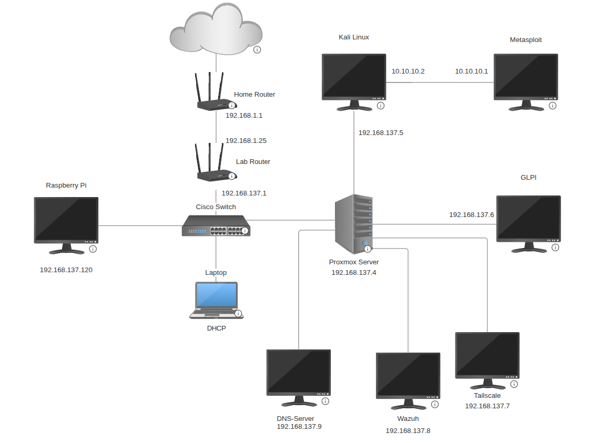

# Home Lab Infrastructure

> **Version:** 1.5.2  
> **Focus:** Networking, cybersecurity, Linux administration, virtualization, and monitoring  
> **Lab subnet:** `192.168.137.0/24`

A personal home lab for learning enterprise networking, infrastructure administration, monitoring, and security testing. The lab is separated from the primary home network by a Cisco router performing NAT.

## Goals

- Configure and troubleshoot Cisco routing, switching, DHCP, NAT, VLANs, and port mirroring.
- Run Linux systems and virtual machines using Proxmox VE.
- Monitor availability with Uptime Kuma and analyze traffic with ntopng.
- Practice authorized penetration testing in isolated environments.
- Document changes, configurations, and recovery procedures.

## Network topology



## Addressing plan

| Device / network | Address | Assignment | Notes |
|---|---|---|---|
| Home LAN | `192.168.1.0/24` | Existing | Outside lab |
| Lab LAN | `192.168.137.0/24` | Existing | Cisco-side subnet |
| Cisco router LAN | `192.168.137.1` | **Verify** | Assumed gateway |
| Cisco switch management | `192.168.137.2 (PLANNED)` | Static | for SSH |
| Proxmox host | `192.168.137.4` | Static IP | Management UI on port 8006 |
| Kali Linux VM | `192.168.137.5, 10.10.10.2 (isolated network)` | Static IP | Confirm unused and outside DHCP pool |
| Ubuntu Server GLPI | `192.168.137.6` | Static IP | Used to run GLPI AD ticket web app, accessed on port 8080 |
| Ubuntu Server Tailscale | `192.168.137.7` | Static IP | Remote connection |
| Wazuh Siem Server | `192.168.137.8` | Static IP | |
| DNS Server | `192.168.137.9` | Static IP | |
| Raspberry Pi | `192.168.137.120` | Static IP | Reserve this address if desired |
| Metasploitable 2 | `10.10.10.1` | Static IP | Intentionally vulnerable machine for pentesting (isolated from main network) |
| Linux Laptop | | DHCP | |

**Addressing rules:** Verify the router's DHCP pool before choosing static IPs. Prefer DHCP reservations for infrastructure when possible. Record all assignments and changes here.

## Hardware inventory

| Equipment | Model | OS / firmware | Purpose |
|---|---|---|---|
| Cisco router | TBD | Cisco IOS / TBD | NAT, routing, DHCP |
| Cisco switch | TBD | Cisco IOS / TBD | Switching, VLANs, SPAN |
| Proxmox server | TBD | Proxmox VE / TBD | Virtualization |
| Raspberry Pi | TBD | Raspberry Pi OS / TBD | Monitoring |
| Linux desktop | TBD | Linux / TBD | Administration |

### Switch port map

| Port | Connected device | VLAN | Notes |
|---|---|---|---|
| TBD | Cisco router | TBD | Uplink |
| TBD | Proxmox host | TBD | VM bridge uplink |
| TBD | Raspberry Pi | TBD | Monitoring |
| TBD | Linux desktop | TBD | Workstation |
| TBD | SPAN destination | TBD | If configured for traffic capture |

### Service inventory

| Service | Host | Port | Protocol | Startup |
|---|---|---|---|---|
| Proxmox UI | Proxmox | 8006 | HTTPS | Host service |
| Uptime Kuma | Raspberry Pi | 3002 | HTTP | Docker restart policy |
| ntopng | Raspberry Pi | 3001 | HTTPS | systemd |
| SSH | Applicable hosts | 22 (verify) | SSH | systemd / host OS |

## Cisco configuration reference

### Router checks

```text
show ip interface brief
show ip route
show ip dhcp binding
show ip nat translations
show access-lists
show running-config
```

### Switch checks

```text
show interfaces status
show interfaces description
show vlan brief
show mac address-table
show interfaces trunk
show monitor session all
show running-config
```

Keep sanitized configuration backups under `configs/`. Never commit passwords, private keys, SNMP communities, or other secrets.

## Monitoring plan

| Target | Method | Endpoint | Maintenance policy |
|---|---|---|---|
| Cisco router | Ping | Gateway IP (verify) | Planned network work |
| Cisco switch | Ping | Management IP (if configured) | Planned network work |
| Proxmox | Ping / HTTPS | `192.168.137.4` (verify) | Planned host work |
| Raspberry Pi | Ping | `192.168.137.120` (current) | Planned reboot |
| ntopng | HTTPS | `https://192.168.137.120:3001` | Service upgrades |
| Kali VM | Ping | `192.168.137.10` (planned) | Manual maintenance while off |

For the self-signed ntopng certificate, configure the Kuma monitor to trust that certificate or explicitly ignore TLS verification **only for this trusted internal endpoint**. A login redirect (HTTP 302) may be an acceptable healthy response.

## Security practices

- Keep the home network and lab network separated; review Cisco NAT and ACL rules.
- Restrict Proxmox, SSH, and monitoring dashboards to trusted management devices.
- Use unique strong credentials; store them in a password manager, not this repository.
- Apply OS and package updates regularly.
- Back up Proxmox VMs, Raspberry Pi configurations, and Uptime Kuma's persistent data.
- Isolate intentionally vulnerable VMs from ordinary devices and the internet.
- Only test systems owned by you or explicitly authorized for testing.
- Document changes to firewall rules, VLANs, bridges, and IP allocations.

## Troubleshooting quick reference

```bash
# Raspberry Pi interfaces and routes
ip -br addr
ip route

# Service availability
sudo systemctl status docker ntopng --no-pager
sudo docker ps -a

# Check web ports
sudo ss -lntp | grep -E ':3001|:3002|:8006'

# Docker networking
sudo docker network ls
sudo docker inspect uptime-kuma --format '{{json .NetworkSettings.Networks}}'

# Docker logs
sudo journalctl -u docker -b -l --no-pager

# Test ntopng HTTPS locally
curl -kI https://127.0.0.1:3001/

# Test Kuma HTTP locally
curl -I http://127.0.0.1:3002/
```

## Backup and recovery

| Asset | Backup method | Frequency | Restore tested? |
|---|---|---|---|
| Cisco configurations | Export sanitized running/startup config | After changes | TBD |
| Proxmox VMs | Proxmox Backup / vzdump | TBD | TBD |
| Uptime Kuma | Back up Docker volume with container stopped or consistent backup method | TBD | TBD |
| ntopng configuration | Back up `/etc/ntopng/` and relevant settings | After changes | TBD |
| Documentation | Git repository | Every change | N/A |

Store at least one backup outside the Proxmox host and Raspberry Pi. Record actual recovery steps once tested.

### Change Log (Summary)

| Version | Date | Change |
|---------|------------|--------------------------------|
| 1.5.2 | 2026-11-06 | Updated Uptime Kuma monitoring |
| 1.5.1 | 2026-11-05 | Configured DNS Records |
| 1.5.0 | 2026-11-04 | Configured Wazuh and DNS Server |
| 1.4.0 | 2026-11-02 | Configured Tailscale |
| 1.3.0 | 2026-10-30 | Set up Metasploit VM |
| 1.2.0 | 2026-10-29 | Configured GLPI Server |
| 1.1.0 | 2026-10-29 | Set up Uptime Kuma |


## Repository Structure

```text
home-lab/
├── README.md
├── diagrams/
│   └── network-topology.png
├── configs/
│   ├── cisco-router.example.txt
│   └── cisco-switch.example.txt
├── docs/
│   ├── addressing.md
│   ├── hardware-inventory.md
│   ├── change-log.md
│   ├── backup-recovery.md
│   └── troubleshooting.md
├── services/
│   ├── uptime-kuma.md
│   └── ntopng.md
└── vms/
    ├── kali-linux.md
    └── metasploitable.md
```

## References

- [Proxmox VE documentation](https://pve.proxmox.com/pve-docs/)
- [Kali Linux documentation](https://www.kali.org/docs/)
- [Uptime Kuma repository](https://github.com/louislam/uptime-kuma)
- [ntopng documentation](https://www.ntop.org/guides/ntopng/)
- [Docker documentation](https://docs.docker.com/)

---

**Documentation convention:** Replace `TBD`, `planned`, and `verify` entries as configurations are confirmed. Keep credentials and sensitive inventory details out of public repositories.
